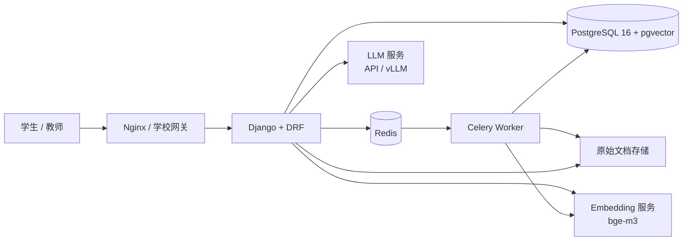

# 教学智能体 · 课程知识库问答

一个面向高校课程答疑场景的 **RAG 智能助教框架**：教师上传课程资料，学生用自然语言提问；系统先检索课程知识库，再由大模型生成**带引用、可追溯、资料不足会拒答**的回答。

> 这是课程作业的**框架实现**，不是完整产品。目标是跑通一条可演示、可扩展的链路：**课程权限 → 资料上传 → 解析入库 → 向量检索 → 引用生成 → 反馈闭环**。流式输出、OCR、Reranker、SSO 等已预留接口，见 [路线图](#9-路线图)。

- 设计方案（功能、模型合理性、数据与数据库、部署运维、费用）：[docs/项目设计方案.md](docs/项目设计方案.md)
- 技术栈：**Django 5 + DRF + PostgreSQL/pgvector + Celery + Redis + OpenAI 兼容模型接口**

---

## 1. 功能定位

**做**：课程范围内的知识库问答、引用溯源、无依据拒答、教师待办问题池、资料版本标记与重新解析。

**不做**：通用百科问答、自动评分、学术不端认定、未授权资料抓取、跨课程内容访问。

核心设计原则：

1. **检索在前、生成在后**：大模型只看到教师审核过的 Top-K 片段，不凭参数记忆回答课程事实。
2. **引用由工程校验**：模型输出 `[n]`，后端解析并关联真实片段，前端展示原文。
3. **阈值拒答**：检索最高分不足时不调用生成模型，直接拒答并记录教师待办。
4. **课程强隔离**：API 校验授课/选课关系，检索按文档的课程归属过滤，避免跨课程召回。
5. **模型可替换**：`LLM_BASE_URL` / `EMBEDDING_BASE_URL` 指向公有云 API 或本地 vLLM / Xinference。

## 2. 架构



一次问答的调用链：

```text
问题 → 课程权限校验 → Embedding → pgvector Top-K → 阈值过滤
     → 组装带编号资料 → LLM 生成 → 解析 [n] 引用 → 落库 → 返回前端
```

## 3. 已实现能力

| 模块 | 能力 |
|---|---|
| 账号 | 自定义用户（学生/教师/管理员）、Session + Token 认证、Django Admin |
| 课程 | 课程、选课关系、课程级可访问性过滤 |
| 知识库 | 文档上传/文本录入、PDF/DOCX/PPTX/TXT/MD 解析、标题/段落分块、向量化、解析任务状态 |
| 问答 | 课程范围检索、相似度阈值、带引用回答、拒答、多轮短上下文、token/时延记录 |
| 反馈 | 有用/没用、低分问题进入教师待办、教师可标记处理 |
| 前端 | 登录页、课程问答页、引用展示、反馈按钮 |
| 工程 | Docker Compose、Makefile、Celery、健康检查、环境变量配置、HNSW 索引脚本 |

**当前明确未实现**：流式输出/SSE、OCR、BM25 混合检索、Reranker、问题改写、SSO、教师数据看板、自动化评测脚本。

## 4. 快速开始（Docker，推荐）

要求：Docker Desktop / Docker Engine + Compose v2。

```bash
cd teaching-agent
cp .env.example .env
# 编辑 .env，至少填写 LLM_API_KEY 与 EMBEDDING_API_KEY
docker compose up -d --build
```

等待容器健康后，创建管理员与演示数据：

```bash
docker compose exec web python manage.py createsuperuser
docker compose exec web python manage.py seed_demo
```

打开：

- 问答页：<http://127.0.0.1:8000/>（学生 `demo_student / student123`）
- 管理后台：<http://127.0.0.1:8000/admin/>（演示管理员 `demo_admin / admin123`，或刚创建的管理员）

### 导入第一份资料

1. 使用 `demo_admin` 登录 `/admin/`；
2. 在「课程文档」中新增文档，选择课程 `CS101`，上传 PDF/DOCX/PPTX/TXT/MD，或直接在「直接录入文本」粘贴内容；
3. 保存后执行解析：

```bash
docker compose exec web python manage.py ingest_course --course CS101 --sync
```

4. 使用 `demo_student` 登录问答页提问。若回答提示无资料，请检查文档状态是否为「可检索」，以及 `.env` 中的 Embedding 配置。

> 资料内容未变化时，解析任务会跳过重复向量化；更换 Embedding 模型或修改 `EMBEDDING_DIM` 后，请用 `--force` 并在新库中重建全部向量。

> 演示用账号密码仅用于本地开发，部署前请删除或修改。

### 停止 / 重置

```bash
docker compose down          # 停止
docker compose down -v       # 停止并删除数据库/媒体卷（会丢数据）
```

## 5. 本地开发（不使用 Docker 运行 Web）

要求：Python 3.10+、PostgreSQL 16（安装 pgvector）、Redis 6+。

```bash
cd teaching-agent
cp .env.example .env
python -m venv .venv
# Windows
.venv\Scripts\activate
# macOS / Linux
# source .venv/bin/activate

python -m pip install -r requirements.txt
```

准备数据库（任选其一）：

```bash
# 方式一：只用 Docker 启动依赖
docker compose up -d db redis

# 方式二：已有 PostgreSQL，手动创建库并启用扩展
psql -U postgres -c "CREATE DATABASE teaching_agent;"
psql -U postgres -d teaching_agent -c "CREATE EXTENSION IF NOT EXISTS vector;"
```

初始化并启动（迁移文件已提交，直接执行即可）：

```bash
python manage.py migrate
python manage.py seed_demo
python manage.py createsuperuser
python manage.py runserver
```

如果修改了模型，先执行 `python manage.py makemigrations` 生成迁移并一并提交。

另开终端启动异步解析：

```bash
make worker
# 或手动指定配置：
# DJANGO_SETTINGS_MODULE=config.settings.dev celery -A config worker -l info --concurrency=2
```

如果本地不想启动 Redis + Worker，可在 `.env` 设置 `CELERY_TASK_ALWAYS_EAGER=true`，解析任务会同步执行。

## 6. 配置说明

完整模板见 [.env.example](.env.example)。

| 变量 | 作用 | 默认值 |
|---|---|---|
| `DJANGO_SETTINGS_MODULE` | 配置模块 | `config.settings.dev` |
| `DJANGO_SECRET_KEY` | Django 密钥，生产必须修改 | 开发占位值 |
| `DJANGO_ALLOWED_HOSTS` | 允许的域名 | `localhost,127.0.0.1` |
| `DATABASE_URL` | PostgreSQL 连接串（需 pgvector） | 本地 `teaching_agent` |
| `REDIS_URL` / `CELERY_*` | 缓存与任务队列 | 本地 Redis |
| `LLM_BASE_URL` | 对话模型 OpenAI 兼容地址 | DeepSeek |
| `LLM_API_KEY` | 对话模型密钥 | 空 |
| `LLM_CHAT_MODEL` | 对话模型名 | `deepseek-chat` |
| `EMBEDDING_BASE_URL` | Embedding 兼容地址 | SiliconFlow |
| `EMBEDDING_API_KEY` | Embedding 密钥 | 空 |
| `EMBEDDING_MODEL` | Embedding 模型 | `BAAI/bge-m3` |
| `EMBEDDING_DIM` | 向量维度，必须与模型一致 | `1024` |
| `RETRIEVAL_TOP_K` | 送入上下文的片段数 | `6` |
| `RETRIEVAL_SCORE_THRESHOLD` | 余弦相似度阈值 | `0.35` |
| `MAX_CONTEXT_CHARS` | 上下文长度上限 | `6000` |
| `CHUNK_SIZE` / `CHUNK_OVERLAP` | 分块长度/重叠 | `800` / `120` |
| `LLM_MAX_OUTPUT_TOKENS` | 单次回答上限 | `800` |

**切换私有化模型**示例：

```ini
LLM_BASE_URL=http://gpu-server:8000/v1
LLM_API_KEY=EMPTY
LLM_CHAT_MODEL=Qwen2.5-14B-Instruct
EMBEDDING_BASE_URL=http://gpu-server:8001/v1
EMBEDDING_API_KEY=EMPTY
EMBEDDING_MODEL=BAAI/bge-m3
```

只要服务兼容 OpenAI 的 `/chat/completions` 与 `/embeddings` 协议，无需改代码。

## 7. API 一览

认证方式：Web 页面使用 Session + CSRF；脚本使用 `Authorization: Token <token>`。

| 方法 | 路径 | 说明 |
|---|---|---|
| POST | `/api/v1/auth/token/` | 用户名密码换 Token |
| GET | `/api/v1/auth/me/` | 当前用户 |
| GET | `/api/v1/courses/` | 当前用户可访问的课程 |
| GET/POST | `/api/v1/documents/?course=1` | 文档列表 / 创建（教师） |
| PATCH/DELETE | `/api/v1/documents/{id}/` | 修改 / 删除（教师） |
| POST | `/api/v1/documents/{id}/ingest/` | 触发异步解析 |
| GET | `/api/v1/ingestion-jobs/?document=1` | 解析任务状态 |
| POST | `/api/v1/courses/{id}/ask/` | 提问，返回回答与引用 |
| GET | `/api/v1/conversations/?course=1` | 我的会话 |
| POST | `/api/v1/messages/{id}/feedback/` | 有用/没用 |
| GET | `/healthz/` | 健康检查 |

示例：

```bash
# 1. 获取 Token
curl -s -X POST http://127.0.0.1:8000/api/v1/auth/token/ \
  -H "Content-Type: application/json" \
  -d '{"username":"demo_student","password":"student123"}'

# 2. 提问
curl -s -X POST http://127.0.0.1:8000/api/v1/courses/1/ask/ \
  -H "Authorization: Token <TOKEN>" \
  -H "Content-Type: application/json" \
  -d '{"question":"实验三中排序算法的时间复杂度要求是什么？"}'
```

响应（节选）：

```json
{
  "id": 12,
  "conversation_id": 3,
  "role": "assistant",
  "content": "实验三要求能说明快速排序平均 O(n log n)、最坏 O(n^2) 的原因 [1]。",
  "status": "ok",
  "latency_ms": 2310,
  "citations": [
    {
      "chunk_id": 41,
      "document_title": "实验三指导书",
      "rank": 1,
      "score": 0.62,
      "quote": "实验三：比较冒泡、插入、快速排序在最好、平均、最坏情况下的时间复杂度……"
    }
  ]
}
```

## 8. 目录结构

```text
teaching-agent/
├─ README.md
├─ Makefile
├─ requirements.txt
├─ .env.example
├─ Dockerfile
├─ docker-compose.yml
├─ manage.py
├─ config/
│  ├─ settings/{base,dev,prod}.py
│  ├─ urls.py / wsgi.py / asgi.py / celery.py
├─ apps/
│  ├─ accounts/          # 自定义用户、角色、Token
│  ├─ courses/           # 课程、选课、课程级权限
│  ├─ knowledge/         # 文档、分块、解析任务、管理 API
│  │  ├─ services/       # extractors.py / ingestion.py
│  │  └─ management/     # seed_demo / ingest_course
│  └─ qa/                # 会话、消息、引用、反馈、RAG
│     └─ services/       # embeddings / llm / prompts / rag
├─ templates/            # 登录页、问答页
├─ static/css/app.css
├─ scripts/              # 数据库扩展 / HNSW 索引
└─ docs/
   └─ 项目设计方案.md
```

### 核心代码入口

- 检索与生成：[apps/qa/services/rag.py](apps/qa/services/rag.py)
- 系统提示词：[apps/qa/services/prompts.py](apps/qa/services/prompts.py)
- 文档解析入库：[apps/knowledge/services/ingestion.py](apps/knowledge/services/ingestion.py)
- 数据模型：[apps/knowledge/models.py](apps/knowledge/models.py)、[apps/qa/models.py](apps/qa/models.py)
- 课程权限：[apps/courses/selectors.py](apps/courses/selectors.py)
- 问答 API：[apps/qa/views.py](apps/qa/views.py)

## 9. 路线图

| 优先级 | 内容 | 说明 |
|---|---|---|
| P0 | 流式输出 / SSE | 改善等待体验；需处理引用在流式结束后的解析 |
| P0 | 混合检索 + Reranker | pgvector 召回 + 中文关键词召回，bge-reranker 精排 |
| P1 | OCR | 扫描件 PDF、图片型课件 |
| P1 | 问题改写 | 多轮对话下把“那它呢”改写成独立问题再检索 |
| P1 | 教师看板 | 待办问题、拒答率、点赞率、文档覆盖度 |
| P1 | 资料版本回滚 | 基于 `version` 字段保留历史片段，支持一键回退 |
| P2 | 学校 SSO | CAS / OAuth2 / LDAP，角色同步 |
| P2 | 自动化评测 | 黄金集回归、引用准确率、拒答正确率 |
| P2 | 多租户隔离 | 按院系/课程做更细的配额与审计 |

## 10. 测试与质量

```bash
make check       # Django 系统检查
make test        # Django 测试
make lint        # Ruff 静态检查
make format      # Ruff 格式化
```

建议在真实课程上维护 100～200 题黄金集，至少跟踪：

- Recall@5（正确片段是否在前 5 条）
- 引用准确率、回答有据率
- 拒答正确率（该拒的拒、不该拒的不拒）
- P95 时延、每千次问答 token 成本

## 11. 部署与安全要点

生产部署请使用 `config.settings.prod`，并至少完成：

- 替换 `DJANGO_SECRET_KEY`，设置真实 `DJANGO_ALLOWED_HOSTS`、`CSRF_TRUSTED_ORIGINS`；
- 使用 Gunicorn + Nginx，开启 HTTPS/HSTS；
- 数据库独立部署，每日备份并定期恢复演练；
- Redis 设置密码与内网访问；
- Web 与 Celery Worker 分开扩容；
- 密钥通过环境变量 / Secret 管理，不进入镜像和 Git；
- 管理员启用 MFA，后台限制访问来源；
- 按学校规定设置会话保留期限与数据删除流程；
- 生产环境不要直接暴露 `/media/`：原始课件应通过受保护的下载接口或带签名的对象存储 URL 提供；
- 生产部署执行 `python manage.py collectstatic --noinput` 供 WhiteNoise/Nginx 使用。

详细拓扑、备份策略、监控指标、SOP 与费用见 [项目设计方案](docs/项目设计方案.md) 第 4、5 节。

## 12. 仓库与提交

如果当前目录尚未初始化 Git：

```bash
cd teaching-agent
git init -b main
git add .
git commit -m "feat: bootstrap teaching agent RAG framework"
```

注意事项：

- `.env`、`media/`、`staticfiles/` 已在 `.gitignore` 中忽略；
- 提交前运行 `make check` / `make lint`；
- 初始迁移已提交，可直接 `python manage.py migrate`；生产环境不要在启动脚本中自动 `makemigrations`；
- 模型密钥、学生数据、真实课程资料不要进入仓库。

---

**说明**：本项目为课程设计与演示原型，不构成学业评价、学术不端认定或自动决策系统；AI 回答需由教师和学生核对引用原文后使用。
